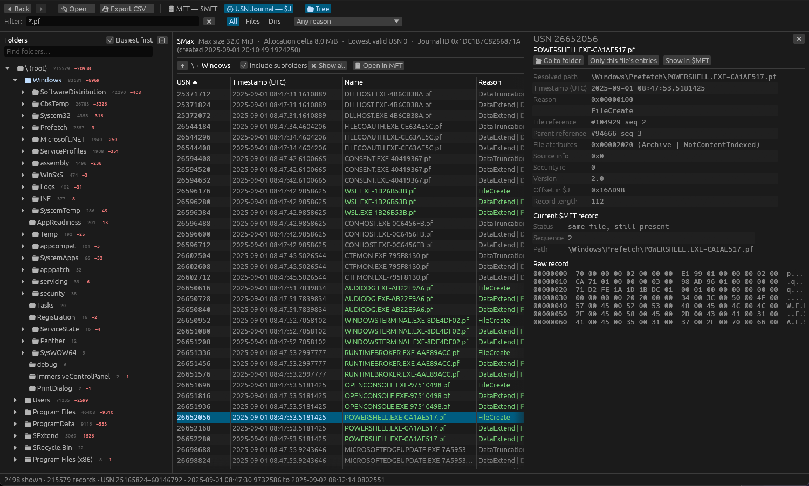

# Sediment

*Every action leaves a layer.*

Sediment is a desktop app for investigating Windows machines. Open a triage collection or a
disk image and see what was on the drive, what changed, and what ran, linked together,
with built-in detections mapped to MITRE ATT&CK.

Free for small teams · Windows, macOS and Linux · runs entirely on your machine



## Install

One command, no administrator rights:

**Windows** (PowerShell)

```powershell
irm https://nyanites.github.io/sediment/install.ps1 | iex
```

**macOS and Linux** (Terminal)

```sh
curl -fsSL https://nyanites.github.io/sediment/install.sh | sh
```

The installer downloads the latest [release](https://github.com/Nyanites/sediment/releases),
checks it against its published checksum and installs it for your user. Sediment then keeps
itself up to date (Help → Check for updates).

## What it does

**Detections, mapped to ATT&CK.** Built-in rules flag attacker tools, credential theft,
timestomping, persistence, log tampering, ransomware-style mass renames and more. The
🛡 Detections menu groups them by tactic and severity; pick one to jump straight to every
hit, with what the rule checks, likely false positives and references.

**Files and folders, including deleted ones.** Browse the drive's folder tree from its
`$MFT` like File Explorer, deleted entries included, with every detail of every file:
timestamps, alternate data streams, hard links and timestomping signs.

**Every change, over time.** The USN change journal as a timeline and as a folder tree of
where activity happened, with the full history of any file: created, renamed, changed,
deleted.

**What ran, and what it could do.** Prefetch shows run counts and times, with known attacker
tools named and capabilities read from the libraries a program loaded.

**Connected.** Jump from a program that ran, to the files it loaded, to everything that
happened to them, and back.

**Hash and check.** Right-click a file for its MD5, SHA-1 and SHA-256 to SHA-512, and check
it on VirusTotal or Triage with your own API keys.

**Extract safely.** Save any file, even a deleted one, into a ZIP locked with the password
`infected`. Small files come straight out of the `$MFT`; open the disk image (E01 or raw/dd)
and files of any size come out.

## Getting started

- **Open a collection:** Open folder… (or drag it onto the window). Sediment finds the
  `$MFT`, `$J`, `$Max` and prefetch files inside it by their content, in subfolders too.
- **Open a disk image:** 🖴 Image → Open disk image… (E01 or raw/dd). Its `$MFT` is loaded
  and every file can be hashed and extracted.
- **From the command line:** `sediment $MFT $J $Max C:\cases\host1\Prefetch`
- **Check hashes online:** add your VirusTotal or Triage API key when asked, or any time in
  Help → Settings.

Any file that can't be read is listed in the load report (Details… in the status bar);
everything else still loads.

## Privacy

Your evidence never leaves your machine unless you send it. Sediment checks GitHub once a day
for a new version (you can turn this off in Help → Settings), and contacts VirusTotal or
Triage only when you click a check or submit button. Submissions always ask first. There is
no telemetry and no account.

## Build from source

```
cargo build --release
```

## Security

Found a problem? Please report it privately: see [SECURITY.md](SECURITY.md).

## License

[PolyForm Small Business License 1.0.0](LICENSE.md): free for organizations with fewer than
100 people and under US$1M in revenue. Larger organizations need a commercial license.
Third-party notices: [NOTICE.md](NOTICE.md).
